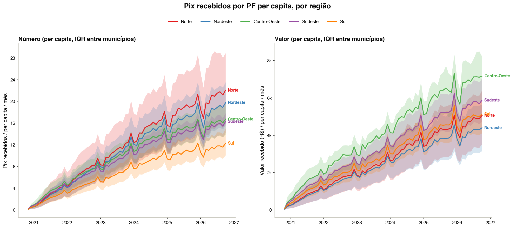

# Pix recebidos por PF per capita, por região

Análise autocontida que compara as 5 regiões do Brasil quanto ao **número** e ao
**valor** de Pix recebidos por pessoa física (PF), per capita, ao longo do tempo.



Os principais resultados estão resumidos em [results.md](results.md).

## O que gera

`output/pix_regioes_recebidos.png`, dois subplots lado a lado:

- **Número (esquerda)**: Pix recebidos por PF per capita, por mês, a razão
  entre o total de Pix e o total de habitantes da região (ponderada pela
  população). A banda é o intervalo interquartílico (P25-P75) ponderado entre
  municípios.
- **Valor (direita)**: valor recebido (R$) por PF per capita, por mês, com a
  mesma agregação ponderada e a mesma banda.

Cada linha colorida é uma região.

O mesmo dado é salvo em `output/pix_regioes_recebidos.csv` (colunas: `metrica`,
`regiao`, `ano_mes`, `per_capita`, `p25`, `p75`, `iqr`).

## Como rodar

```bash
pip install -r requirements.txt
python pix_regioes_recebidos.py
```

Regera `output/pix_regioes_recebidos.png` e `output/pix_regioes_recebidos.csv`.

## Dados (crus, sem transformação)

Os CSVs em `data/` são **dados crus**, valores originais das APIs, sem limpeza.
As únicas seleções feitas foram: escolher as colunas usadas e descartar o mês
atual (parcial).

| Arquivo | Fonte | Conteúdo |
|---|---|---|
| `data/transacoes_pix_municipio.csv` | BCB, Estatísticas do Pix | quantidade e valor recebidos por PF, por município/mês (só as 4 colunas usadas) |
| `data/populacao_municipios_2026.csv` | IBGE, Estimativas da População | população por município (2026) |

## Como os dados foram baixados (para auditar)

O script `download_data.py` refaz o download do zero, direto das APIs oficiais:

```bash
python download_data.py
```

**Pix, BCB Olinda OData v1** (`Pix_DadosAbertos`), recurso
`TransacoesPixPorMunicipio`, baixado **mês a mês** (o recurso é um *function
import* que exige o parâmetro `DataBase`; `$skip` não funciona):

```
https://olinda.bcb.gov.br/olinda/servico/Pix_DadosAbertos/versao/v1/odata/TransacoesPixPorMunicipio(DataBase=@DataBase)?@DataBase='AAAAMM'&$top=2000000&$filter=AnoMes eq AAAAMM&$format=json
```

São mantidas só as colunas `AnoMes, Municipio_Ibge, QT_RecebedorPF,
VL_RecebedorPF`, e o mês atual (parcial) é descartado.

**População, IBGE**, "Estimativas da População", agregado 6579, variável 9324,
período 2026, nível N6 (município):

```
https://servicodados.ibge.gov.br/api/v3/agregados/6579/periodos/2026/variaveis/9324?localidades=N6[all]
```

## Observação metodológica

- O "per capita" de cada região é a **razão de somas** (`soma de Pix / soma
  de habitantes`), que equivale a ponderar os municípios pela população. A banda
  sombreada é o **intervalo interquartílico (P25-P75) ponderado** entre
  municípios, a dispersão típica, robusta a valores extremos.
- Três municípios criados em 2024/2025 só têm Pix a partir da criação e ficam
  fora do denominador nos meses anteriores (juntos, ~0,01% da população, efeito
  desprezível).
- A métrica divide por **população total** (inclui menores de idade). Para
  comparar o **ranking entre regiões** isso é robusto; os valores absolutos
  "per capita" ficam levemente subestimados nas regiões mais jovens
  (Norte/Nordeste).
- O denominador usa a **população de 2026 fixa** para toda a série. Consideramos
  população ano a ano, mas a variação 2021-2026 é pequena (~0,4% no Brasil;
  ≤4% na região que mais cresce), então mantivemos o dado mais recente.
- Os valores estão em **reais nominais** (não deflacionados). Isso não afeta o
  ranking entre regiões, mas infla a leitura do crescimento ao longo do tempo.
